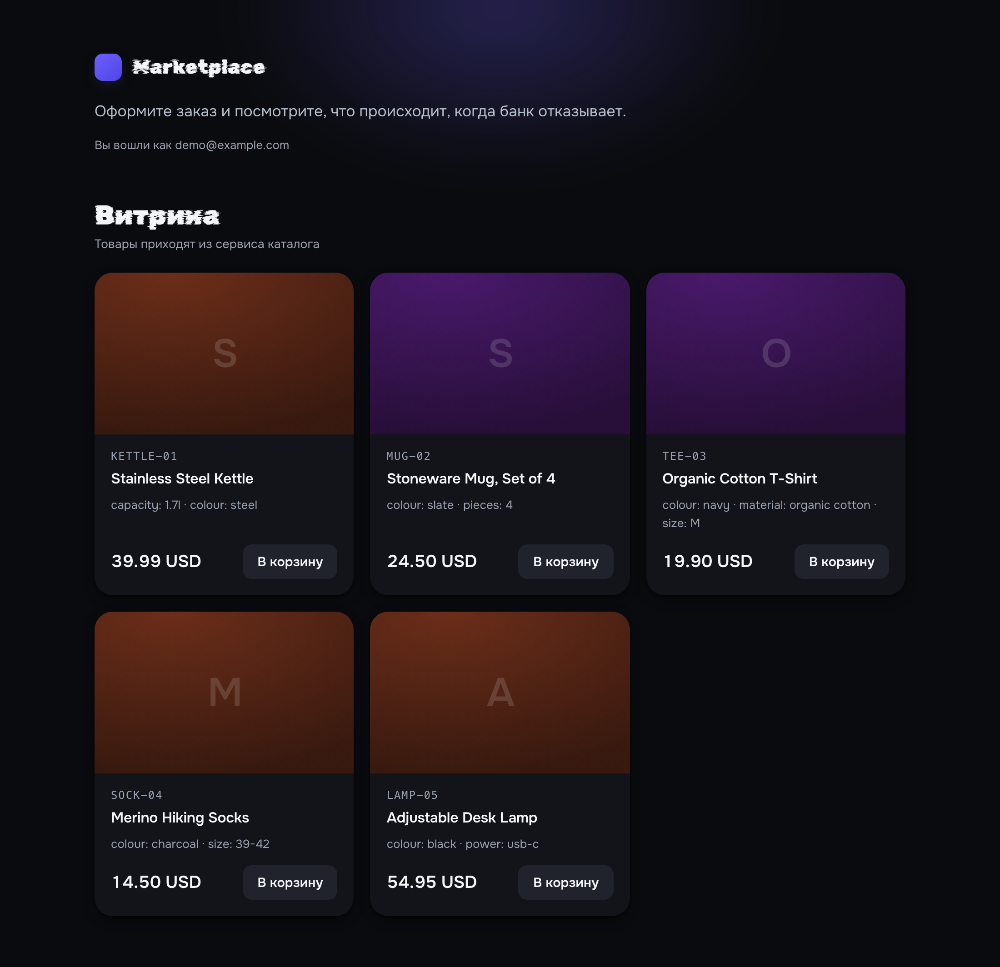
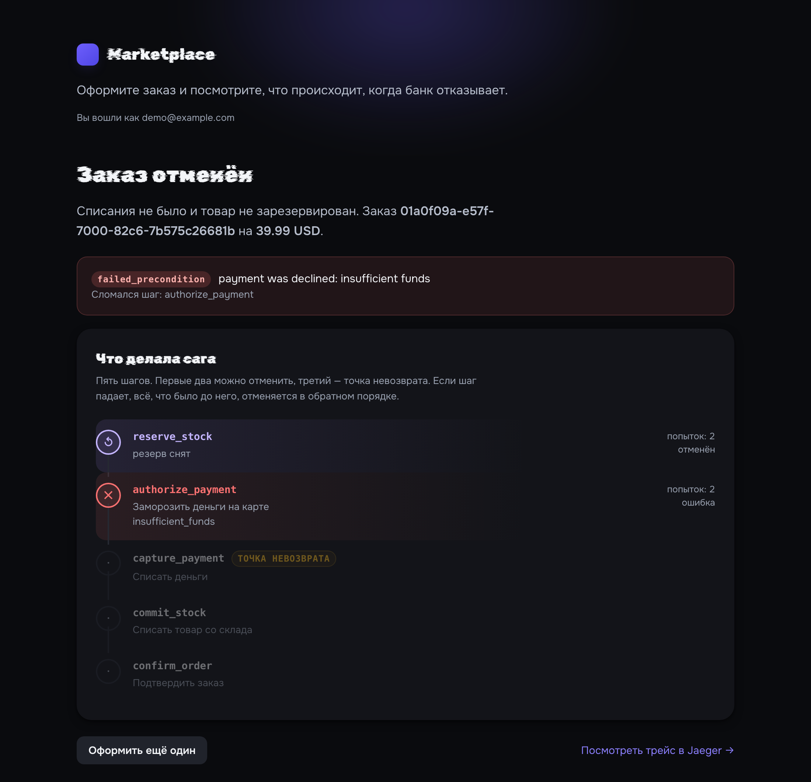

# marketplace

A microservice marketplace whose interesting part is not the CRUD — it is the checkout.

Placing an order touches five services, each with its own database: stock must be reserved,
payment must be authorized, and the order must be confirmed. Any of those steps can fail, and
the failure can arrive after an earlier step has already changed state. This repository is a
working implementation of that problem, built around an **orchestrated saga with explicit
compensations**, and instrumented well enough to prove the rollback actually happened.

```
Buyer ──REST──▶ Gateway ──gRPC──▶ Order (saga orchestrator)
                                     │
                     ┌───────────────┼───────────────┬──────────────┐
                     ▼               ▼               ▼              ▼
                 Catalog        Inventory        Payment      Notification
                 (prices)      (reservation)   (authorize)     (consumer)
                     │               │               │              ▲
                     └───────────────┴───────────────┴──────────────┘
                                        Kafka
```

## The problem this solves

A checkout is a distributed transaction, and distributed transactions are the thing
two-phase commit promises and rarely delivers. The concrete failure being defended against:

```
1. Order service      : order created          ✔ (committed to order_db)
2. Inventory service  : 2 units reserved       ✔ (committed to inventory_db)
3. Payment service    : card declined          ✘
                          ⚠ the reservation from step 2 is now orphaned stock
                          ⚠ the order from step 1 is now unpayable
```

There is no transaction spanning those two databases, and a rollback is not a `ROLLBACK`
statement — it is a sequence of **new business operations** that undo committed work. That
sequence is a saga, and it is the core of this codebase.

**Reserve → commit is the pivot.** Everything before the pivot can be undone; the design keeps
the irreversible step (capturing payment, committing stock) as late as possible.

## What is actually implemented

The project is built in stages; this section is kept honest as it progresses.

| Capability | Status |
|---|---|
| Monorepo, proto contracts, codegen, Docker stack | ✅ done |
| Shared foundation (`pkg`: config, logging, errors, health, bootstrap) | ✅ done |
| `pkg/money` — exact monetary arithmetic | ✅ done |
| `pkg/resilience` — retry with backoff/jitter, circuit breaker | ✅ done |
| `pkg/saga` — saga engine: compensation, resume, recovery worker | ✅ done |
| `pkg/jwtx`, `pkg/grpcx`, `pkg/ratelimit` — edge and transport plumbing | ✅ done |
| Order domain, checkout saga, idempotency | ✅ done |
| Catalog, inventory and payment services over gRPC | ✅ done |
| API gateway: JWT, rate limiting, REST to gRPC | ✅ done |
| Checkout demo running end to end | ✅ **verified** |
| Embedded storefront at `/ui/` with a saga timeline | ✅ done |
| Auth service: registration, login, refresh rotation, reuse detection | ✅ done |
| Gateway auth routes (`/v1/auth/*`) | ✅ done |
| PostgreSQL for the order service: migrations, optimistic locking, outbox | ✅ done |
| PostgreSQL for catalog, inventory, payment, auth, notification | ✅ done |
| Kafka: outbox poller, deduplicating consumers, notification service | ✅ done |
| OpenTelemetry traces across gRPC *and* Kafka | ✅ done |
| Kubernetes manifests, GitHub Actions CI, kind scripts | ✅ done |
| Applied to a real kind cluster: 15/15 pods running, checkout verified | ✅ done |
| Grafana dashboard, Prometheus metrics (RED + domain) | ✅ done |
| k6 checkout load test | ✅ done |
| C4 diagrams in `docs/architecture.md` | ✅ done |

Current state: **398 tests passing with the race detector** across 33,400 lines of hand-written
Go, and the full 13-container stack (7 services, PostgreSQL, Kafka, Redis, Jaeger, Prometheus,
Grafana) comes up healthy.

The checkout path runs end to end and `make demo` exercises it against the live API. What the
demo shows, and what these tests cover, is the part of the system most likely to be wrong:

- a card declined **after** stock has been reserved — the reservation is released, the
  authorization is voided, the order is cancelled, and the two irreversible steps never run;
- a transient provider timeout — retried before compensating, not rolled back on first failure;
- a compensation that itself fails — the remaining compensations still run, and the order is
  flagged `failed` for a human rather than being reported as a clean rollback;
- a process that dies mid-saga — the recovery worker resumes it without reserving twice;
- eight concurrent retries of one checkout — exactly one order and exactly one charge;
- a retry with the same idempotency key — the original order replayed, not a second one.

## Load test

`make k6` drives a mixed checkout profile — 70% approved, 20% permanently
declined, 10% transient — so the compensation path runs under load rather than
only in unit tests. A steady run:

| | |
|---|---|
| orders confirmed | 3198 |
| orders rolled back | 1377 (the declined cards, as intended) |
| sagas needing a human | **0** |
| server errors | **0** |
| checkout latency | p95 421 ms, p99 458 ms |
| throughput | ~27 checkouts/s |

The throughput figure is bounded by the container runtime's port forwarding on a
laptop, not by the services: no service exceeded 5% CPU during the run. The
latency and correctness figures are the meaningful ones.

Three real defects were found by running it, none of which any unit test had
covered — see the commit history. The most instructive: the address-based rate
limiter was applied to every route, so it throttled authenticated checkouts to
the allowance meant for a human logging in. A load test from one address hit it
immediately; so would every customer behind a corporate NAT.

## Try it

`make up` opens the storefront when the gateway is ready — a product grid, a
cart, and a payment-method selector whose options are *make this payment
decline*, *make this payment time out* and *let it through*. Placing an order
renders the saga's five steps with their real outcome, so the rollback is
something you watch rather than something you read about.



Choosing the card that declines and pressing pay gives this:



Two steps are violet because they were **compensated** — the stock hold was
released and the authorization voided — one is red because it **failed**, and
three are dimmed because they **never ran**. The orange marker is the pivot: the
step after which nothing can be undone. That is the entire argument of the
design, visible in one screen.

It is plain HTML, CSS and one JavaScript file, embedded in the gateway binary:
no second container, no CORS, no build step. A bundler would make the demo the
most complicated part of the repository.

The two typefaces — Rubik Glitch for the brand and the section headings, Onest
for everything read at length — are also embedded, as latin and cyrillic subsets
only. Loading them from a CDN would make
an external network a dependency of a demo that runs on localhost, and would be
the one part of the page that stops working offline.

Underneath, the same things the API exposes:

```bash
make demo      # runs the three scenarios above against the live API
make token     # prints a development access token, if you want to poke at it by hand
make k6        # load test the checkout path (needs k6 on PATH)
```

| | |
|---|---|
| Jaeger | <http://localhost:16686> — a checkout is one trace across four services |
| Grafana | <http://localhost:3000> — the *Marketplace — checkout and sagas* dashboard |
| Prometheus | <http://localhost:9090> — eight targets, all up |

The dashboard separates the three saga outcomes deliberately: **completed** is
success, **compensated** is the system working — a declined card that left nothing
behind — and **failed** means stock or money is stuck and somebody should be
paged. Collapsing them into one "failures" panel would hide the distinction that
matters.

Architecture diagrams — system context, containers, and the checkout sequence for
both the happy path and the rollback — are in [`docs/architecture.md`](docs/architecture.md).
The public HTTP contract is in [`docs/openapi.yaml`](docs/openapi.yaml).

## Services

| Service | Responsibility | Database |
|---|---|---|
| **gateway** | Public REST edge: JWT verification, rate limiting, gRPC fan-out | — |
| **auth** | Identities, credentials, access/refresh tokens | `auth_db` |
| **catalog** | Products and prices; the source of the checkout price snapshot | `catalog_db` |
| **inventory** | Stock levels and the two-phase reservation lifecycle | `inventory_db` |
| **order** | The saga orchestrator: step execution, compensation, recovery | `order_db` |
| **payment** | Payment provider adapter with idempotency and simulated declines | `payment_db` |
| **notification** | Kafka consumer that notifies customers | — |

One database per service, and no foreign key ever crosses a database boundary. Integrity
between services is the saga's job, not the database's.

## Engineering decisions worth reading

Each of these is documented as an ADR in [`docs/adr`](docs/adr) with its alternatives and
the reasoning for rejecting them.

- **Orchestrated saga over choreography.** The checkout flow is fixed and short; a central
  orchestrator makes the failure path readable in one place instead of reconstructable only
  by reading five consumers.
- **Transactional outbox over dual writes.** Writing to the database and publishing to Kafka
  cannot be made atomic without a distributed transaction, so the event is written to an
  `outbox` table in the same transaction as the state change, and a poller publishes it.
  Delivery is at-least-once; consumers are idempotent.
- **Idempotency keys on every retryable command.** A timeout is not a failure — it is an
  unknown. `AuthorizePayment` and `CreateOrder` store their results under a caller-supplied
  key so a retry returns the original outcome instead of charging twice.
- **Deterministic reservation ids.** The order service passes its own order id as the
  reservation id, which makes `ReserveStock` naturally idempotent under saga retries.
- **Errors are transport-neutral.** `pkg/apperr` classifies failures once; the gRPC and HTTP
  layers translate. Domain code imports neither `net/http` nor `grpc`.
- **Distroless images.** No shell, no package manager, no libc. Health checks use a
  `-health-check` mode of the service binary itself.

## Quickstart

Requirements: Docker (or Colima), GNU Make, Go 1.25+ for working on the code.

```bash
git clone <this repo> && cd marketplace

make up          # creates .env from .env.example, builds and starts everything
make ps          # what is running
make logs        # follow
```

Then:

| | URL |
|---|---|
| API gateway | http://localhost:8080 |
| Jaeger (traces) | http://localhost:16686 |
| Grafana (dashboards) | http://localhost:3000 |
| Prometheus | http://localhost:9090 |

Tear down with `make down` (also removes volumes).

## Working on the code

The workspace root is not a Go module — it is a `go.work` file spanning eight modules, so
`go test ./...` from the root will not work. Use the Makefile, which runs each goal inside
every module:

```bash
make build              # build all seven binaries into ./bin
make test               # unit tests, no infrastructure required
make test-race
make test-integration   # real Postgres, Kafka and Redis, started in-process
make proto              # regenerate Go code from .proto (requires `make tools`)
make vet
```

`make test-integration` is worth calling out: it runs against a **real** PostgreSQL binary,
a **real** Kafka protocol implementation and a **real** Redis, each started in-process by the
test binary. No Docker, no testcontainers, and the suite stays fast enough to run on save.

## Repository layout

```
.
├── go.work                  # workspace spanning every module
├── Makefile                 # the only entry point you need
├── proto/                   # .proto contracts — the source of truth for all APIs
│   ├── auth/ catalog/ inventory/ order/ payment/
│   ├── common/              # Money, pagination, audit
│   └── events/              # Kafka message schemas
├── pkg/                     # shared library, one module
│   ├── apperr/              # transport-neutral error taxonomy
│   ├── bootstrap/           # process lifecycle shared by all services
│   ├── config/              # environment loading with accumulated errors
│   ├── health/              # liveness, readiness, version probes
│   ├── idgen/               # monotonic UUID v7 identifiers
│   ├── logger/              # structured logging with trace correlation
│   ├── proto/               # generated code (committed, never hand-edited)
│   └── version/             # build metadata
├── services/<name>/         # one module per service
│   ├── cmd/<name>/          # main: wiring only
│   └── internal/            # domain, application, adapters, transport
├── deploy/
│   ├── docker-compose.yml   # the whole stack
│   ├── docker/Dockerfile    # one Dockerfile, parametrised by service
│   ├── k8s/                 # Kubernetes manifests
│   ├── postgres/            # database bootstrap
│   ├── prometheus/          # scrape configuration
│   └── grafana/             # provisioned data sources and dashboards
├── migrations/              # per-service SQL migrations
└── test/                    # end-to-end and load tests
```

Each service follows the same shape, and the dependency rule points inward:

```
transport (gRPC/HTTP) ──▶ app (use cases) ──▶ domain (rules, no imports)
                                │
                                └──▶ ports (interfaces) ◀── adapters (Postgres, Kafka, Redis)
```

The domain and the saga logic depend on nothing but the standard library, which is precisely
why the compensation logic can be tested without a database.

## Configuration

Everything is environment-driven; see [`.env.example`](.env.example) for the full list with
comments. Real environment variables always win over the `.env` file, so a container can be
overridden without editing anything checked in.

A misconfigured service lists **all** of its problems at startup rather than one per restart —
`pkg/config` accumulates parse errors instead of failing on the first.

## License

MIT
