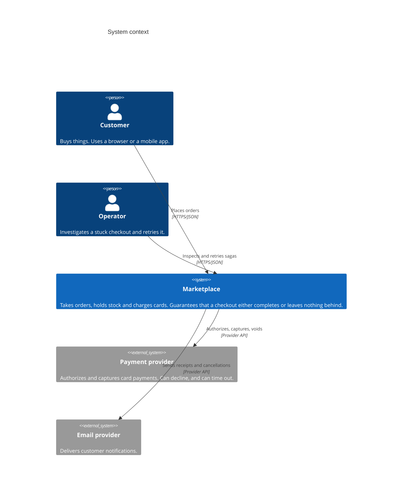
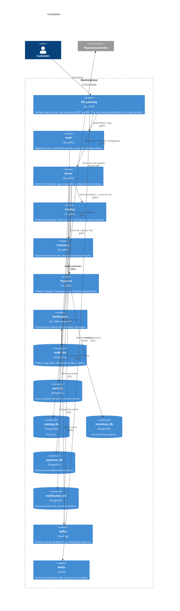
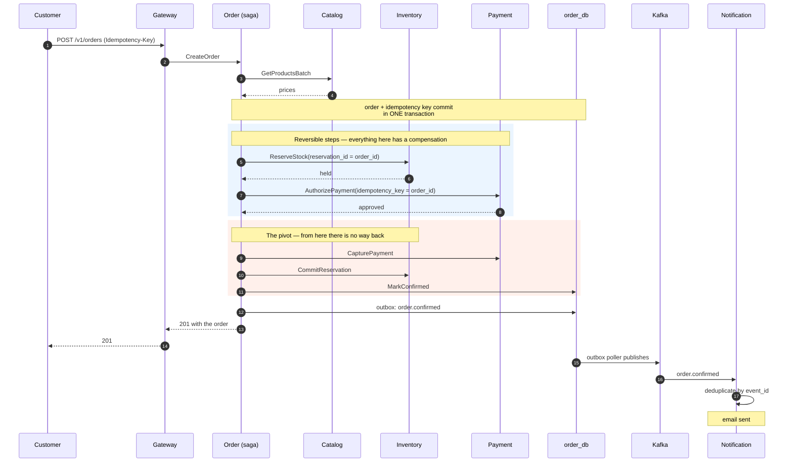
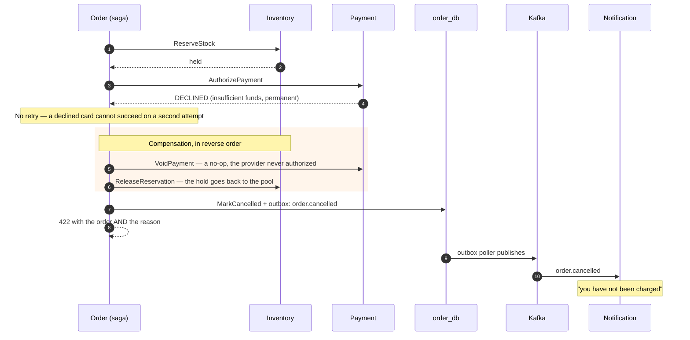
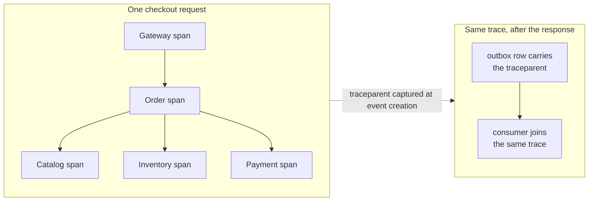

# Architecture

Three views of the same system, at three levels of zoom. The point of showing all
three is that a microservice architecture is only defensible if you can describe
what each service is for and why the boundary is where it is — a single diagram
of boxes and arrows invites the question "why not one service?" and answers none
of it.

- [Level 1 — System context](#level-1--system-context): who uses this, and what it depends on
- [Level 2 — Containers](#level-2--containers): the services and their stores
- [Level 3 — The checkout flow](#level-3--the-checkout-flow): the sequence that the whole project exists for

---

## Level 1 — System context

The only interesting thing here is what is **outside** the boundary. The payment
provider can decline or time out, and neither is under our control — which is
precisely why the system needs compensations rather than a rollback statement.

---

## Level 2 — Containers

**Why these boundaries.**

| Service | Owns | Why it is separate |
|---|---|---|
| `auth` | Credentials and tokens | The only service that ever sees a password, so the blast radius of a logging mistake is one service |
| `order` | The checkout flow | The only service that knows the *shape* of a checkout; every other service exposes a capability |
| `catalog` | Prices | Pricing changes far more often than checkout, and on a different schedule |
| `inventory` | Stock | The one place that must never oversell, so it holds a lock and nobody else does |
| `payment` | The provider relationship | Swapping providers must not touch the checkout logic |
| `notification` | What the customer is told | Async, slow, and allowed to fail without affecting a sale |

No foreign key crosses a database boundary. Referential integrity between services
is the saga's job — see [ADR-0005](../adr/0005-database-per-service.md).

---

## Level 3 — The checkout flow

The saga, including the path that matters. Everything before `capture_payment` can
be undone; nothing after it can.

And the same flow when the card is refused:

`capture_payment`, `commit_stock` and `confirm_order` never run. That is the
property the whole project exists to demonstrate, and `make demo` shows it against
the running system rather than asserting it in a test.

---

## Cross-cutting

Two things that are easy to get wrong and are deliberate here:

- **The error taxonomy is transport-neutral.** `pkg/apperr` classifies a failure
  once; the gRPC and HTTP layers each translate it. Domain code imports neither
  `grpc` nor `net/http`.
- **The trace context is captured where the event is created, not where it is
  published.** The outbox poller runs seconds later on its own goroutine; injecting
  the context there would attach the event to the poller and break the causal
  chain. See [ADR-0002](../adr/0002-transactional-outbox.md).
